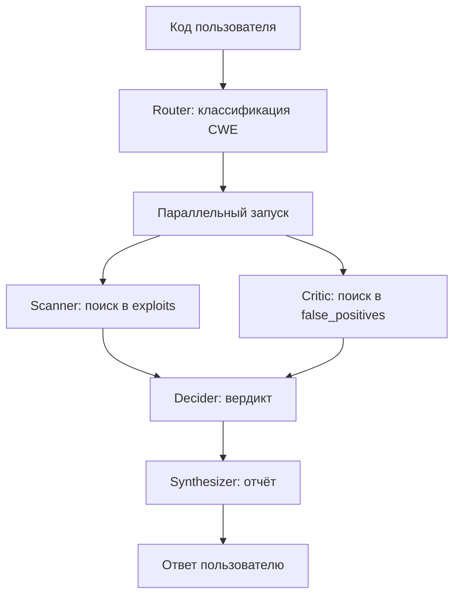

# Multi-Agent RAG для аудита безопасности кода

Система получает фрагмент C/C++ кода и возвращает один из трёх вердиктов:

- `vulnerable` — код похож на уязвимый;
- `false_positive` — тревога похожа на ложное срабатывание;
- `inconclusive` — данных недостаточно или два retrieval-контура противоречат друг другу.

В основе проекта лежит dual-RAG: Сканер ищет похожие уязвимые примеры в коллекции `exploits`, а Критик независимо ищет безопасные примеры в `false_positives`. Затем Decider сравнивает результаты, а Синтезатор формирует понятный отчёт.



Scanner и Critic запускаются параллельно. Critic не использует CWE-фильтр Router, поэтому ошибка Router не блокирует независимую проверку безопасных аналогов.

## Состояние проекта

MVP собран end-to-end:

- подготовлен Juliet-датасет для пяти CWE;
- созданы и заполнены две коллекции Qdrant;
- реализованы Scanner и Critic;
- Router и Synthesizer работают через локальную Ollama;
- узлы объединены в LangGraph;
- есть FastAPI и Streamlit интерфейс;
- результаты eval записываются в JSONL и MLflow;
- в ветке `retiveval-v2` добавлена оценка retrieval по документам и проверка утечек.

Следующий обязательный этап — независимый frozen test, которого нет в Qdrant. После него можно обоснованно сравнивать dense retrieval с BM25/hybrid retrieval и другими embedding-моделями.

## Что изменилось в `retiveval-v2`

Раньше retrieval считался успешным, если в top-k встречался правильный CWE. Такая проверка слишком слабая: десятки нерелевантных документов могут иметь тот же CWE.

В этой ветке:

- релевантность определяется по `document_id` или `function_id`;
- добавлены Recall@1, Recall@3, Recall@5, MRR@5 и nDCG@5;
- Scanner и Critic оцениваются отдельно;
- Scanner проверяется с CWE-фильтром и без него;
- совпадение CWE оставлено только как диагностическая метрика;
- в Qdrant добавлены стабильные идентификаторы и происхождение данных;
- реализована проверка exact duplicate, near duplicate, совпадений функций и Juliet-семейств;
- сохранён воспроизводимый baseline конфигурации, данных, Qdrant и метрик;
- добавлены unit-тесты для идентификаторов, retrieval-метрик и leakage-check.

## Стек MVP

- Python 3.11
- Qdrant — хранение векторов и payload
- `BAAI/bge-small-en-v1.5` — dense embeddings, размерность 384
- SentenceTransformers — вычисление embeddings
- LangGraph — оркестрация агентов
- Ollama + `qwen2.5-coder:7b` — Router и Synthesizer
- FastAPI — HTTP API
- Streamlit — пользовательский интерфейс
- MLflow — история экспериментов и метрик
- unittest — автоматические проверки

Для BGE документы кодируются с префиксом `passage:`, запросы — с `query:`. Векторы нормализуются, расстояние в Qdrant — cosine.

## Данные MVP

Источник — подготовленный Juliet C/C++ в `data/dataset.jsonl`:

- всего 4111 функций;
- `kind=bad`: 1741 уязвимый пример;
- `kind=good`: 2370 безопасных примеров;
- CWE: 23, 78, 134, 190 и 476;
- source-only функции и строки с `POTENTIAL FLAW` удалены при подготовке данных.

После чанкинга в Qdrant находится:

- `exploits`: 3629 чанков;
- `false_positives`: 2537 чанков.

Стратегии чанкинга различаются:

- exploits: `chunk_size=512`, `chunk_overlap=128`;
- false positives: `chunk_size=1024`, `chunk_overlap=256`.

Крупный контекст для Critic нужен, чтобы retrieval видел не только потенциально опасную операцию, но и проверку, которая делает код безопасным.

## Файлы проекта

### `csec/config.py`

Содержит общую конфигурацию:

- адрес Qdrant и имена коллекций;
- embedding-модель и размер вектора;
- пути к датасету и метаданным;
- список CWE для MVP;
- лимит строк;
- параметры двух сплиттеров.

### `csec/embeddings.py`

Отвечает за embeddings:

- лениво загружает `BAAI/bge-small-en-v1.5`;
- добавляет префиксы `passage:` и `query:`;
- нормализует векторы;
- возвращает векторы документов и запросов.

Отдельного файла с заранее сохранёнными токенами нет. Токенизацию выполняет tokenizer BGE внутри `encode()`.

### `csec/ingest/create_collections.py`

Создаёт коллекции `exploits` и `false_positives` с cosine distance и payload-индексами:

- `cwe`;
- `document_id`;
- `function_id`;
- `project_id`;
- `source_dataset`;
- `split`.

Флаг `--recreate` удаляет и заново создаёт только эти две воспроизводимые коллекции. Он нужен при изменении размерности вектора или миграции старого payload-контракта.

### `csec/ingest/common.py`

Общая ingest-логика:

- читает строки `bad` или `good` из датасета;
- нормализует CWE к виду `CWE78`;
- нормализует код перед хэшированием;
- создаёт стабильные `document_id`, `function_id`, `project_id` и `chunk_id`;
- делит функции на чанки;
- вычисляет embeddings;
- выполняет пакетный upsert в Qdrant.

ID строятся из содержимого и происхождения данных, поэтому не зависят от порядка загрузки. ID точки Qdrant — детерминированный UUID5 от `chunk_id`.

### `csec/ingest/load_exploits.py`

Загружает `kind=bad` в `exploits` с чанкингом 512/128. Эту коллекцию использует Scanner.

### `csec/ingest/load_false_positives.py`

Загружает `kind=good` в `false_positives` с чанкингом 1024/256. Эту коллекцию использует Critic.

### `csec/search.py`

Содержит retrieval-функции:

- `search_exploits(code, cwe=None, limit=3)` — поиск Scanner с опциональным CWE-фильтром;
- `search_false_positives(code, limit=3)` — независимый поиск Critic без CWE-фильтра.

Обе функции возвращают score и payload найденных точек.

### `csec/router.py`

Router через Ollama определяет основную CWE-категорию и действие:

- уверенная поддерживаемая категория передаётся Scanner как фильтр;
- `unknown`, `no_match` или низкая уверенность отключают фильтр, но не останавливают анализ.

### `csec/decider.py`

Сравнивает верхние результаты Scanner и Critic по порогам и возвращает `vulnerable`, `false_positive` или `inconclusive`.

Cosine score означает сходство кода, а не вероятность уязвимости. Поэтому пороги Decider должны калиброваться на независимом eval-наборе.

### `csec/synthesizer.py`

Получает код, готовый вердикт и результаты двух retriever-ов. Через `qwen2.5-coder:7b` формирует summary, explanation и recommendation. При ошибке Ollama или невалидном JSON возвращает шаблонный fallback и не роняет весь граф.

### `csec/graph.py`

Собирает полный LangGraph:

`START → Router → (Scanner ∥ Critic) → Decider → Synthesizer → END`.

`analyze_code(user_code)` — основная точка входа для API и внешнего кода.

### `api/`

- `main.py` — FastAPI app, lifecycle и endpoints;
- `schemas.py` — Pydantic-модели запросов и ответов;
- `serializers.py` — перевод Qdrant hits и состояния графа в API-ответ;
- `deps.py` — проверки готовности Qdrant и Ollama.

### `ui/streamlit_app.py`

Streamlit-интерфейс для отправки кода в FastAPI. Показывает вердикт, отчёт, latency, данные Router и при включённом debug — находки Scanner/Critic.

## Контракт точки Qdrant

Каждая точка содержит вектор `float[384]` и payload:

- `code` — текст чанка;
- `cwe` — нормализованный CWE, например `CWE78`;
- `filename`, `function_name`, `label`;
- `source`, `kind`, `chunk_index`;
- `chunk_id` — стабильный ID чанка;
- `document_id` — стабильный ID исходной функции/документа;
- `function_id` — ID функции с учётом исходного файла;
- `project_id` — ID Juliet-семейства;
- `source_dataset`, `source_file`, `split` — происхождение данных.

API debug-ответ также отдаёт эти идентификаторы, чтобы найденный результат можно было связать с eval-разметкой.

## Retrieval eval v2

### Формат кейса

`evals/cases.jsonl` поддерживает следующую схему:

```json
{
  "id": "case_cwe78_001",
  "code": "...",
  "expected_cwe": "CWE-78",
  "expected_decision": "vulnerable",
  "relevant_document_ids": ["document_..."],
  "relevant_function_ids": ["function_..."],
  "required_sink": "system",
  "required_source": "user_input",
  "split": "test",
  "source_dataset": "manual",
  "query_origin": "external"
}
```

`required_sink` и `required_source` подготовлены для будущего ручного frozen test. В автоматически собранном corpus baseline они могут быть `null`.

### Метрики

- Recall@1/3/5 — доля размеченных релевантных документов, найденных в top-k;
- MRR@5 — насколько высоко находится первый релевантный документ;
- nDCG@5 — качество порядка релевантных документов;
- mean top-1 cosine — диагностическое среднее сходство верхнего результата;
- CWE hit rate@5 — диагностическое наличие правильной категории;
- decision accuracy — совпадение вердикта Decider с ожидаемым.

Scanner считается только на `vulnerable` кейсах, Critic — только на `false_positive`. Один запуск создаёт два режима:

- `retrieval_eval_with_cwe_filter`;
- `retrieval_eval_without_cwe_filter`.

Critic в обоих режимах остаётся без CWE-фильтра.

### Текущий технический baseline

На 20 автоматически выбранных примерах:

| Контур | Recall@1 | Recall@3 | Recall@5 | MRR@5 | nDCG@5 |
| --- | ---: | ---: | ---: | ---: | ---: |
| Scanner | 0.80 | 0.80 | 0.80 | 0.80 | 0.80 |
| Critic | 0.60 | 0.90 | 0.90 | 0.7333 | 0.7762 |

Decision accuracy: `0.95`. Результаты Scanner с CWE-фильтром и без него на этой выборке совпали.

Это проверка технической работоспособности, а не итоговая оценка качества. Leakage-check показал:

- exact duplicate: 20 из 20;
- near duplicate: 20 из 20;
- та же функция: 20 из 20;
- то же Juliet-семейство: 20 из 20;
- чистых независимых кейсов: 0.

Следовательно, текущие retrieval-метрики нельзя использовать как доказательство обобщения на новый код. Для честной оценки нужен frozen test из ручных или внешних примеров, отсутствующих в индексируемом корпусе.

## Eval-файлы

- `evals/build_cases.py` — собирает технический corpus baseline;
- `evals/check_leakage.py` — проверяет exact/near duplicates, функции и семейства;
- `evals/capture_baseline.py` — фиксирует commit, датасет, конфигурацию, объёмы Qdrant и последние метрики;
- `evals/eval_retrieval.py` — считает retrieval v2 в двух режимах;
- `evals/eval_synthesizer.py` — оценивает fallback, grounding и faithfulness отчёта;
- `evals/eval_graph.py` — проверяет Router и полный end-to-end граф;
- `evals/baseline_mvp_v1.json` — снимок MVP до дальнейших экспериментов;
- `evals/leakage_report.json` — подробный отчёт об утечках;
- `evals/results.jsonl` — история запусков eval.

MLflow experiment: `csec-rag-mvp`. Retrieval v2 создаёт отдельные runs для режима с фильтром и без него и сохраняет полный `eval_record.json` как artifact.

## Структура репозитория

```text
README.md
requirements.txt
csec/
  config.py
  embeddings.py
  router.py
  search.py
  decider.py
  synthesizer.py
  graph.py
  ingest/
    common.py
    create_collections.py
    load_exploits.py
    load_false_positives.py
api/
  main.py
  schemas.py
  serializers.py
  deps.py
ui/
  streamlit_app.py
tests/
  test_router.py
  test_graph.py
  test_synthesizer.py
  test_ingest_ids.py
  test_eval_retrieval.py
  test_leakage.py
evals/
  build_cases.py
  check_leakage.py
  capture_baseline.py
  eval_retrieval.py
  eval_synthesizer.py
  eval_graph.py
  benchmark_device.py
  cases.jsonl
  baseline_mvp_v1.json
  leakage_report.json
data/
  dataset.jsonl
  metadata_balanced.jsonl
graph_structure.md
```

## Пересборка retrieval-индекса

При первом создании коллекций:

```bash
python -m csec.ingest.create_collections
python -m csec.ingest.load_exploits
python -m csec.ingest.load_false_positives
```

Если коллекции были созданы до появления стабильных ID или изменилась embedding-модель:

```bash
python -m csec.ingest.create_collections --recreate
python -m csec.ingest.load_exploits
python -m csec.ingest.load_false_positives
```

`--recreate` удаляет содержимое `exploits` и `false_positives`, после чего оно полностью восстанавливается из файлов проекта.

## Запуск eval

```bash
python evals/build_cases.py
python evals/check_leakage.py
python evals/eval_retrieval.py --mode both
python evals/capture_baseline.py
```

Полный eval дополнительно:

```bash
python evals/eval_synthesizer.py
python evals/eval_graph.py
```

## Проверка тестов

```bash
python -m unittest discover -s tests -p "test_*.py" -v
```

Для изменений retrieval v2 проходят семь unit-тестов: стабильность ID, корректность Recall/MRR/nDCG и обнаружение утечек.

## Запуск API и интерфейса

```bash
uvicorn api.main:app --host 127.0.0.1 --port 8000
streamlit run ui/streamlit_app.py
```

- Swagger: `http://127.0.0.1:8000/docs`
- Streamlit: `http://localhost:8501`
- анализ: `POST /analyze`

Пример тела запроса:

```json
{
  "code": "...",
  "include_debug": true
}
```

## Ограничения MVP и следующий этап

- датасет состоит из синтетических Juliet-примеров и содержит много повторяющегося boilerplate;
- dense similarity сама по себе плохо различает source, sink и защитную проверку;
- пороги Decider пока не откалиброваны на независимой выборке;
- текущий corpus baseline содержит полную утечку между запросами и индексом;
- Big-Vul и реальный проектный код пока не подключены;
- статический data-flow/AST-анализ пока отсутствует.

Ближайший порядок работ:

1. собрать и заморозить независимый test-набор с разметкой релевантных документов;
2. исключить exact и near duplicates между Qdrant и test;
3. повторить retrieval v2 и зафиксировать честный baseline;
4. добавить BM25 и сравнить dense, sparse и hybrid retrieval на одном frozen test;
5. после этого проверить code-oriented embeddings и reranker;
6. затем интегрировать лёгкий статический анализ source-to-sink.

Такой порядок позволяет понять вклад каждого изменения, а не улучшать систему по отдельным примерам вручную.
